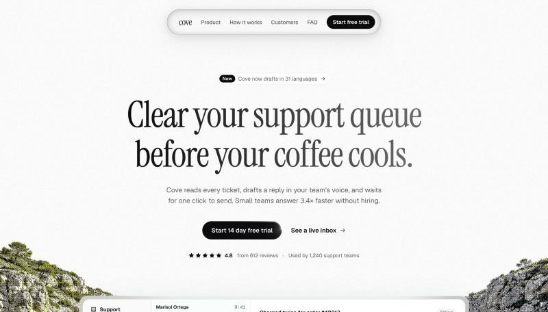
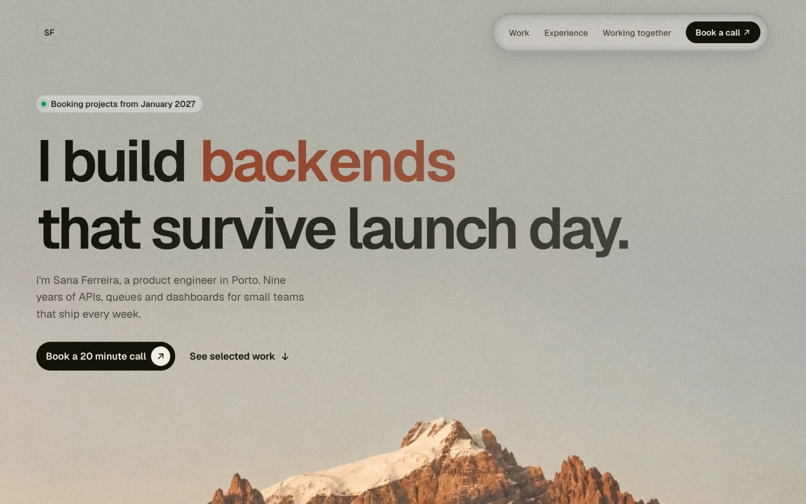
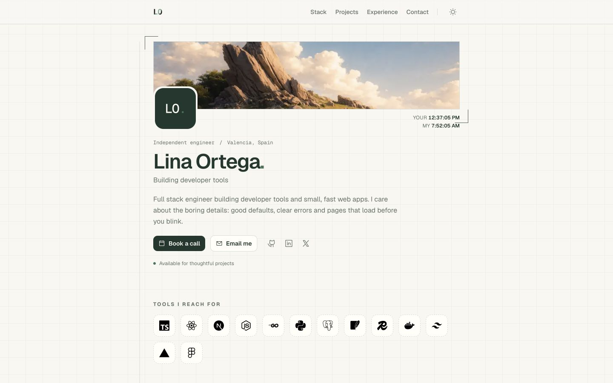
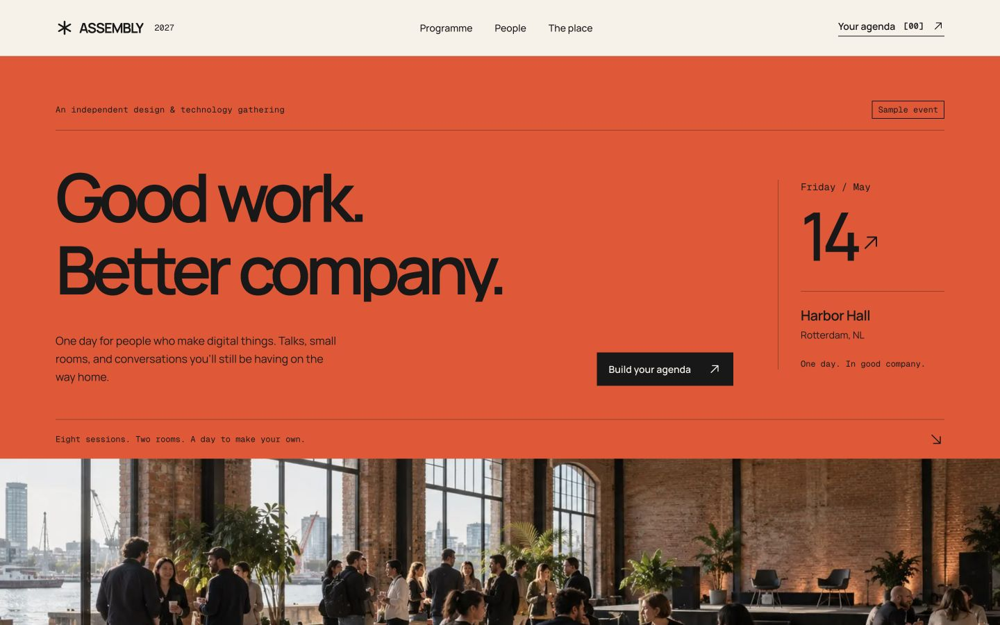

# Senn

[](https://github.com/RusilKoirala/senn/actions/workflows/ci.yml)
[](https://www.npmjs.com/package/senn-ui)
[](LICENSE)
[](https://github.com/RusilKoirala/senn/stargazers)

Beautiful landing pages. Zero design headaches. Completely free.

You've built the product, and now it needs a page. A blank file plus a coding agent usually gets you the same centered hero and grid of cards as everyone else. Paid templates cost money and come wired into someone else's setup. Senn gives you complete, designed landing pages for Next.js that you copy into your project with one command and own outright.

| Modern SaaS | Developer portfolio | Minimal portfolio |
| --- | --- | --- |
|  |  |  |
| `npx senn-ui@latest add modern-saas` | `npx senn-ui@latest add developer-portfolio` | `npx senn-ui@latest add minimal-portfolio` |

Built with Tailwind CSS, shadcn/ui and React Bits. Every template is one self contained folder: sections, copy, theme and images.

### Design conference — Assembly



An event poster with a working programme, personal agenda and calendar export.

```bash
npx senn-ui@latest add design-conference
```

## Use a template

In your Next.js project:

```bash
npx senn-ui@latest add modern-saas
```

It copies the template into `src/templates/modern-saas`, installs its packages, and tells you how to render it. Needs Next.js 15 or newer, React 19 and Tailwind CSS v4.

Then let your coding agent (Claude Code, Cursor, Codex…) turn it into your own product's page:

```bash
npx senn-ui@latest skill modern-saas
```

Other commands: `npx senn-ui@latest list`. See [cli/README.md](cli/README.md).

## Run the site locally

```bash
cd site
pnpm install
pnpm dev
```

Open http://localhost:3000. Templates render on their own at `/t/<template>`.

## Contributing

Bug reports, fixes and new templates are welcome. Anyone can submit a template; the collection is curated, so the ones that fit get added. See [CONTRIBUTING.md](CONTRIBUTING.md).

## Contributors

Everyone who helps gets credited here, for code, design, docs, bug reports and ideas.

<!-- ALL-CONTRIBUTORS-LIST:START - Do not remove or modify this section -->
<!-- prettier-ignore-start -->
<!-- markdownlint-disable -->
<table>
  <tbody>
    <tr>
      <td align="center" valign="top" width="14.28%"><a href="https://github.com/RusilKoirala"><br /><sub><b>Rusil Koirala</b></sub></a><br /><a href="https://github.com/RusilKoirala/senn/commits?author=RusilKoirala" title="Code">💻</a> <a href="#design-RusilKoirala" title="Design">🎨</a> <a href="https://github.com/RusilKoirala/senn/commits?author=RusilKoirala" title="Documentation">📖</a> <a href="#maintenance-RusilKoirala" title="Maintenance">🚧</a> <a href="#infra-RusilKoirala" title="Infrastructure (Hosting, Build-Tools, etc)">🚇</a></td>
    </tr>
  </tbody>
</table>

<!-- markdownlint-restore -->
<!-- prettier-ignore-end -->

<!-- ALL-CONTRIBUTORS-LIST:END -->

## License

[MIT](LICENSE) for Senn's original code. Bundled third party components retain their own licenses; preserve the notices included with each template.
