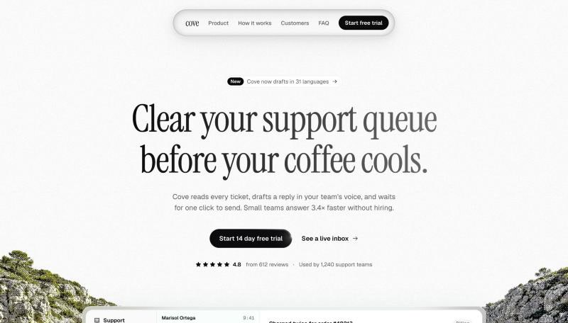
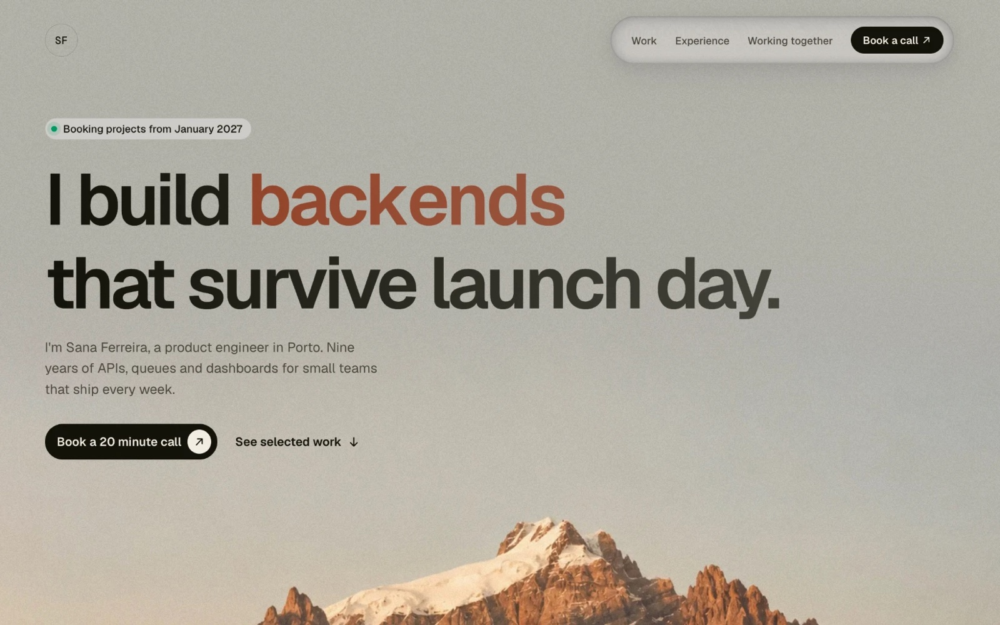
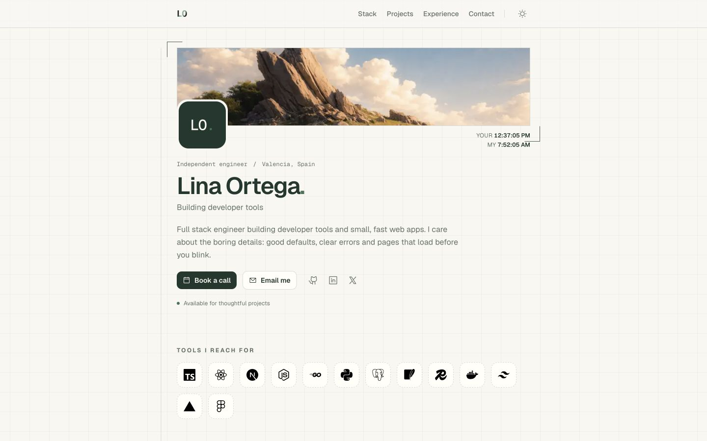
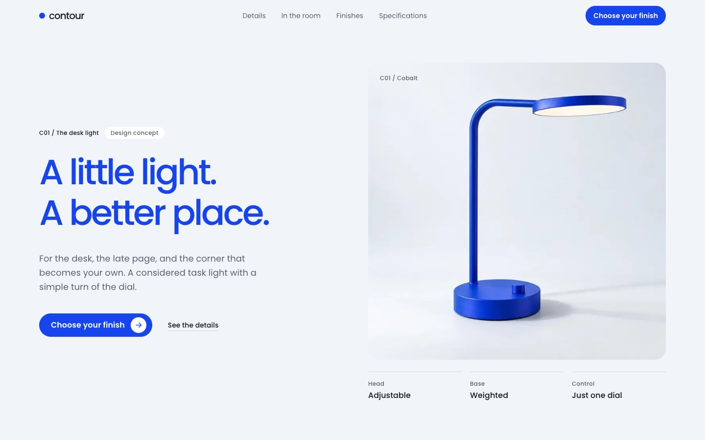
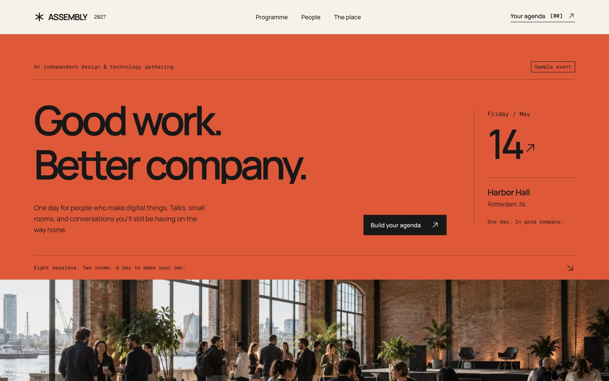

# Senn

[](https://github.com/RusilKoirala/senn/actions/workflows/ci.yml)
[](https://www.npmjs.com/package/senn-ui)
[](LICENSE)
[](https://github.com/RusilKoirala/senn/stargazers)

Senn is a collection of free landing page templates for Next.js :). You run one command, the whole page lands in your project, and it's yours now. Change anything you want, no account, no paying, nothing (yee completely free).

| Modern SaaS | Developer portfolio | Minimal portfolio |
| --- | --- | --- |
|  |  |  |
| `npx senn-ui@latest add modern-saas` | `npx senn-ui@latest add developer-portfolio` | `npx senn-ui@latest add minimal-portfolio` |

## Motivation

You build the product and then it needs a page, and that's where it gets annoying. A blank file plus a coding agent usually gives you the SAME centered hero and grid of cards as everyone else. Paid templates cost money and come wired into someone else's setup. So I wanted real, designed pages that you can just copy in and own. That's Senn!

## Two more templates

### Product design (Contour)



A physical product page where the stuff actually WORKS: finish selector, share link and specification download.

```bash
npx senn-ui@latest add product-design
```

### Design conference (Assembly)



An event poster page with a working programme, personal agenda and calendar export.

```bash
npx senn-ui@latest add design-conference
```

## What this project does

- Five full landing page templates. Each one is one folder with its sections, copy, theme and images.
- A CLI (`senn-ui`) that copies a template into your project and installs only the packages it needs.
- An agent skill for every template, so your coding agent can turn it into your own page.
- A site to look at all of them before you pick one.

## How it flows

1. You pick a template (from the site or `npx senn-ui@latest list`).
2. You run `npx senn-ui@latest add modern-saas` in your Next.js project.
3. The template lands in `src/templates/modern-saas` and its packages get installed.
4. You render it on a route and change `content.ts` to your own words.
5. Or you run the skill command and let your coding agent (Claude Code, Cursor, Codex...) do it. It asks about your product first, then rewrites the copy, colors and images.

```bash
npx senn-ui@latest skill modern-saas
```

You need Next.js 15 or newer, React 19 and Tailwind CSS v4. More about the commands in [cli/README.md](cli/README.md).

## What I learned

Making a template and making a template that works in SOMEONE ELSE'S project are very different things! Next projects can have `src/` or not, people use different package managers, and some already have their own helper files that I must not overwrite. So there's a script that installs every template into both project layouts and checks every file came through the same.

I also learned to stop trusting my own lists :D. The build compares the packages in the catalog with what a template really imports and fails if they don't match.


## Tech Stack

### Site and templates:
- Next.js and React
- TypeScript
- Tailwind CSS v4
- shadcn/ui and React Bits
- GSAP and Motion (FOR THE COOL ANIMATIONS)

### CLI:
- Just Node, no dependencies at all! (fetch, fs and child_process)

## GETTING STARTED

```bash
cd site
pnpm install
pnpm dev
```

Open http://localhost:3000. Templates render on their own at `/t/<template>`.

## Contributing

Bug reports, fixes and new templates are all welcome. Anyone can submit a template. The collection is curated though, so the ones that fit get added. See [CONTRIBUTING.md](CONTRIBUTING.md).

## Contributors

Everyone who helps gets credited here, for code, design, docs, bug reports and ideas.

<!-- ALL-CONTRIBUTORS-LIST:START - Do not remove or modify this section -->
<!-- prettier-ignore-start -->
<!-- markdownlint-disable -->
<table>
  <tbody>
    <tr>
      <td align="center" valign="top" width="14.28%"><a href="https://github.com/RusilKoirala"><br /><sub><b>Rusil Koirala</b></sub></a><br /><a href="https://github.com/RusilKoirala/senn/commits?author=RusilKoirala" title="Code">💻</a> <a href="#design-RusilKoirala" title="Design">🎨</a> <a href="https://github.com/RusilKoirala/senn/commits?author=RusilKoirala" title="Documentation">📖</a> <a href="#maintenance-RusilKoirala" title="Maintenance">🚧</a> <a href="#infra-RusilKoirala" title="Infrastructure (Hosting, Build-Tools, etc)">🚇</a></td>
    </tr>
  </tbody>
</table>

<!-- markdownlint-restore -->
<!-- prettier-ignore-end -->

<!-- ALL-CONTRIBUTORS-LIST:END -->

## License

[MIT](LICENSE) for Senn's original code. Bundled third party components retain their own licenses; preserve the notices included with each template.

## Thank you so much for reading this readme, I really appreciate it :D
